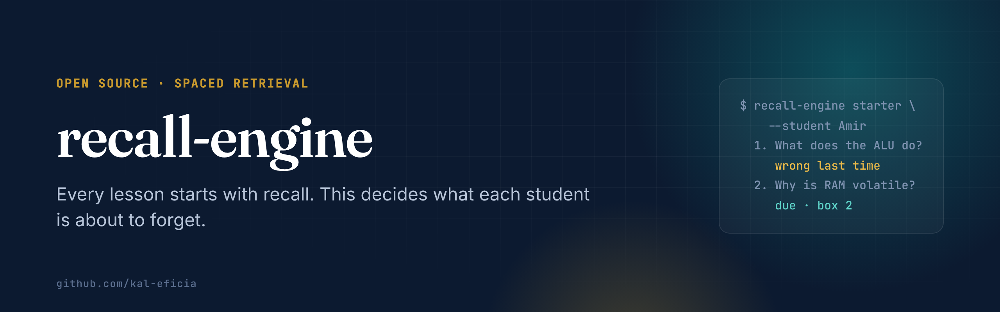

<p align="center"></p>

<p align="center">
  <a href="https://github.com/kal-eficia/recall-engine/actions/workflows/tests.yml"></a>
  
  
  
</p>

The strongest five minutes of any lesson are the first five, if students spend them pulling old knowledge out of memory. The hard part is choosing *which* questions: what is each student about to forget, what did they get wrong last week, what hasn't come up in a month?

**recall-engine** answers that from two plain files most teachers already have: a question bank and a log of who got what right. It builds a short, interleaved starter per student or per class, and a six-week review that shows which topics have actually moved.

```text
$ recall-engine starter --bank examples/bank.csv --log examples/attempts.csv --student Bilal --date 2026-11-25

## Starter for Bilal · Wed 25 Nov 2026

1. What is cloud storage?  (Storage)
2. What is an embedded system?  (Embedded systems)
3. Why is magnetic storage still used in servers?  (Storage)
4. State one difference between RAM and ROM.  (Memory)
...
Why these questions
- Q1: got it wrong last time
- Q6: not asked yet
```

```text
$ recall-engine review --bank examples/bank.csv --log examples/attempts.csv --student Bilal

| Topic   | Baseline | Last 2 weeks | Change  |
|---------|---------:|-------------:|--------:|
| The CPU | 42% (12) |      60% (5) | +18 pts |
```

## How it chooses

Each student and question has a **box** (Leitner style). A right answer moves it up a box; a wrong answer sends it back to the start. Each box has an interval before the question is due again: 1, 3, 7, 14, 30 and 60 days.

A starter is filled in this order:

1. **Due and wrong last time.** It is being forgotten right now.
2. **Due for a check.** Spaced review of things they got right.
3. **Not asked yet**, from topics already taught (about a quarter of the starter), so retrieval keeps widening.
4. **Weakest items** not yet due, if there's space.

Then it **interleaves** the list so no two neighbouring questions share a topic. Mixing topics is harder in the moment and better for memory.

## Install

```bash
pip install git+https://github.com/kal-eficia/recall-engine
```

## Files

**Question bank** (CSV or JSON)

```csv
id,topic,question,answer
H01,The CPU,What does the ALU do?,Carries out arithmetic and logical operations
M01,Memory,Why is RAM described as volatile?,It loses its contents when the power is off
```

**Attempts log** (CSV): one row per answer. Export it from your quiz tool, a form, or a live class dashboard.

```csv
student,question_id,date,result
Amir,H01,2026-10-12,right
Amir,M01,2026-10-15,wrong
```

`result` accepts right/wrong, true/false, 1/0 or correct.

## Commands

```bash
recall-engine starter --bank bank.csv --log log.csv --student Amir --size 8 --answers   # teacher copy
recall-engine class   --bank bank.csv --log log.csv --size 6                            # one per student
recall-engine review  --bank bank.csv --log log.csv --student Amir                      # six-week progress
```

Add `--topics "The CPU,Memory"` to limit new questions to what you have taught, `--date` to plan ahead, and `--json` to feed another tool.

## From Python

```python
from datetime import date
from recall_engine import load_bank, load_log, build_starter

bank, log = load_bank("bank.csv"), load_log("attempts.csv")
for pick in build_starter(bank, log, "Amir", date.today(), size=6):
    print(pick.question.question, "·", pick.reason)
```

## Tests

```bash
python -m unittest discover -s tests
```

The example data in `examples/` is invented: four made-up students across six weeks of a Computer Science hardware unit.

## Related

- [lesson-page-kit](https://github.com/kal-eficia/lesson-page-kit): put the starter on a student page with confidence checks
- [ai-teaching-skills](https://github.com/kal-eficia/ai-teaching-skills): the `recall-starter` skill uses this to plan starters with an AI assistant

---

Built by [Kalid Nur](https://github.com/kal-eficia) for his own recall-first lessons. MIT licence.
